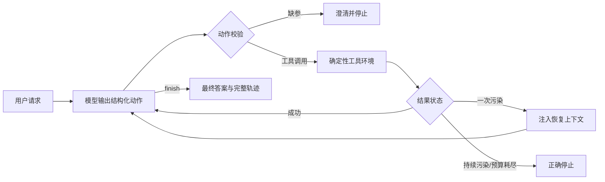

# FSO Agent Runtime Benchmark

> 在冻结模型、Prompt、工具、预算和评分器的前提下，比较 LangGraph 与纯 Python 自研 Agent Runtime 的正确性、轨迹和本地调度开销。

## 结果一览

| 指标 | LangGraph 1.2.11 | 自研 Runtime v1.1 |
|---|---:|---:|
| 冻结 Challenge 严格通过 | 24/24 | 24/24 |
| 成功规划 / 缺参澄清 | 12/12 / 8/8 | 12/12 / 8/8 |
| 语义污染恢复 / 正确停止 | 4/4 / 4/4 | 4/4 / 4/4 |
| 约束违反 | 0 | 0 |
| 模型调用 / Prompt tokens | 112 / 158,535 | 112 / 158,535 |
| 500 组离线本地调度中位数 | 6.210 ms | 0.295 ms |

逐任务比较中，24/24 终止状态、成功配置和工具轨迹一致。离线调度绝对差约 5.898 ms；约 21.06x 只描述无模型网络的本地路径，**不是端到端提速**。

## 为什么这个实验可信

- 先冻结 LangGraph 正式基线，再预注册自研 Runtime，避免看完 Challenge 后调参。
- 两组共用同一 Qwen 模型快照、Prompt、动作 Schema、6 个工具、8 次工具预算、故障环境和评分器。
- 任务、配置、源码与结果使用 SHA-256 固定；正式运行使用一次性账本。
- 完整保留一次凭据格式导致的零 provider 调用事故，并通过独立 v1.1 协议透明恢复。
- 125 项测试与依赖检查通过；结果、轨迹、账本和机器可读配对报告均保存在仓库中。

## Runtime 做了什么



自研实现位于 `src/fso_benchmark/agent_runtime.py` 与 `custom_runtime_contract.py`，不导入 LangGraph 或 langchain-core。它覆盖规划循环、工具路由、参数校验、预算、失败恢复、停止条件和轨迹记录，但不宣称具备 LangGraph 的 checkpoint、并发、人工中断或生态能力。

## 无 API Key 快速复现

```powershell
python -m pip install -e ".[dev]"
python -m pytest -q
python scripts/run_langgraph_offline_smoke.py
python scripts/benchmark_runtime_overhead.py
```

正式模型结果无需重跑即可审阅：

- `docs/CUSTOM_RUNTIME_CHALLENGE_V1_1_REPORT.md`：最终成对比较与边界；
- `artifacts/runtime_comparison_v1_1/report.json`：机器可读配对报告；
- `artifacts/langgraph_model_challenge/` 与 `artifacts/custom_runtime_challenge_v1_1/`：原始轨迹与账本；
- `docs/CUSTOM_RUNTIME_CHALLENGE_INCIDENT.md`：失败运行与透明恢复依据。

## 项目定位

这是一个小型、预注册的受控实验，不是通用 Agent benchmark。24 条 Challenge 足以验证当前冻结任务上的行为保持，但不能外推到开放世界或其他领域。项目复用 FSO 论文仿真的物理公式和已验证汇总结果，不把“调用 Agent”包装成简单计算所必需。

## 实验资料导航

- `docs/CHALLENGE_V1_PREREGISTRATION.md`：LangGraph 正式基线预注册；
- `docs/CUSTOM_RUNTIME_PREREGISTRATION.md`：自研 Runtime 预注册；
- `docs/FROZEN_EVALUATION_CONTRACT.md`：冻结评分与运行约束；
- `docs/CUSTOM_RUNTIME_CHALLENGE_V1_1_REPORT.md`：最终比较、事故披露与结论边界；
- `docs/PROJECT_STATUS.md`：从数据集、规则基线到正式运行的完整进度。

## 确定性工具环境

核心工具覆盖湍流参数计算、OOK BER、湍流档位解析、资源目录读取和约束配置选择。五步规划任务把参数计算、档位解析、目录读取和配置优化串联为可评分轨迹；确定性 Oracle 用于验证任务契约，不代表 LLM 应代替数值优化器。

公式来自本地 FSO 论文仿真的已验证脚本；仓库只保存构建任务所需的冻结子集和来源哈希，不复制大型中间结果或随机仿真流程。详见 `docs/SOURCE_PROVENANCE.md`。
